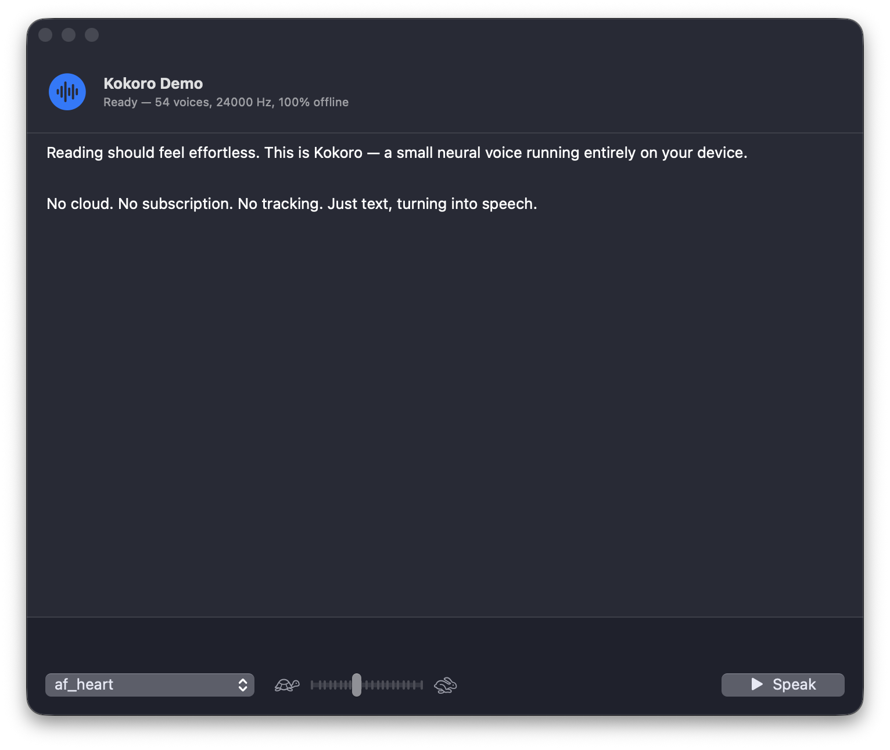

# KokoroTTS — Swift

Native, 100% offline neural text-to-speech for macOS (iOS-ready), built on
**Kokoro-82M** via the [sherpa-onnx](https://github.com/k2-fsa/sherpa-onnx)
C API and ONNX Runtime. No cloud, no subscription, no network permission needed.



## Hear it

Generated on-device by this engine — no post-processing, no cloud.

**English — `af_heart`**
> "Reading should feel effortless. This is Kokoro — a small neural voice running entirely on your device, no cloud, no subscription."

<video controls src="https://github.com/user-attachments/assets/d10763de-a323-4824-bdfe-3b73063954b0"></video>

**Deutsch — `de_DE-thorsten-medium` (Piper pack, same engine interface)**
> "Der Herbst ist dieses Jahr früh gekommen. Am Morgen liegt Nebel über den Feldern, und die Blätter verfärben sich langsam von Grün zu Gold."

<video controls src="https://github.com/user-attachments/assets/7bd38b0f-6f2f-4ade-ab7e-85e9728235a1"></video>

## What this is

- `KokoroTTS` — clean Swift library wrapping the engine (`KokoroEngine`,
  `Voice`, `SynthesizedAudio` with WAV export; whole-text and **streaming**
  sentence-chunk synthesis)
- `kokorocli` — command line tool (list voices, synthesize to WAV, `--stream`
  exercises the chunk callback)
- `KokoroDemo` — simple SwiftUI demo app (voice picker, speed control, playback)
- `KokoroApp` — the production app skeleton: full voice gallery (Featured +
  all 54 voices, searchable), streaming reader with instant audio start

## Quick start

```bash
# One-time: fetch the vendored runtime + model (~1.5 GB download)
./scripts/setup.sh

swift build -c release

# CLI: synthesize (engine auto-detects model.onnx fp32 vs model.int8.onnx)
.build/release/kokorocli \
  --model vendor/kokoro-multi-lang-v1_0 \
  --voice af_heart \
  --text "Reading should feel effortless." \
  --out out.wav

# CLI: stream sentences as they generate (same WAV out)
.build/release/kokorocli \
  --model vendor/kokoro-multi-lang-v1_0 \
  --voice af_heart --stream \
  --text "First sentence. Second sentence."

# CLI: list all 54 voices
.build/release/kokorocli --model vendor/kokoro-multi-lang-v1_0 --list-voices

# Apps
.build/release/KokoroApp      # production skeleton (gallery + streaming reader)
.build/release/KokoroDemo     # simple demo
```

## Measured on Apple Silicon (release, fp32)

- Engine load: ~0.9 s (includes ONNX session init)
- Synthesis: ~4× realtime whole-text, ~1.4× realtime sentence-chunked (CPU only)
- First audio with streaming: starts with the first sentence (~1–2 s), the rest
  synthesizes ahead of playback in the background

## Architecture

```
KokoroApp (SwiftUI) ──┐
KokoroDemo (SwiftUI) ─┤
kokorocli (CLI) ──────┤→ KokoroTTS (Swift API) → CSherpaOnnx (C API shim)
                      │     ↓ thread-safe wrapper (lock-serialized, streaming
                      │     chunk callback bridged via Unmanaged retention)
                      └─→ libsherpa-onnx-c-api.dylib → libonnxruntime.dylib
```

The app layer keeps one persistent `AVAudioEngine` for the process lifetime
(engine start/stop churn races the render thread — a known crash source) and
stops only the player node. A generation counter guarantees stale synthesis
tasks can never enqueue audio after Stop.

The `SpeechEngine`-style seam: everything sits behind `KokoroEngine`, so a
future CoreML/Neural-Engine backend is a drop-in replacement without touching
the UI.

## Model

`vendor/kokoro-multi-lang-v1_0` — Kokoro v1.0, **full precision (fp32)**,
54 voices, 8 languages, 24 kHz, ~394 MB. The engine auto-detects
`model.onnx` (fp32, preferred) vs `model.int8.onnx` (quantized, smaller,
audibly thinner). `voices.txt` came with the int8 pack (same voice order);
copy it into any model dir that lacks one.

> **espeak data note**: if you swap in a different sherpa-onnx model tarball,
> leave `lang:` **empty** in the engine config — a non-empty value is passed
> verbatim to espeak-ng as a voice name and fails (`Failed to set eSpeak-ng
> voice`). Empty = lexicon-driven with espeak only as OOV fallback.

## Licensing

- Code here: MIT
- sherpa-onnx: Apache 2.0 · ONNX Runtime: MIT · espeak-ng: GPL-3.0-with-linking-exception
- Kokoro model: Apache 2.0 (commercial use OK)

## Roadmap (from the plan)

1. ✅ Route A — int8 via sherpa-onnx Swift (this package)
2. ⏳ Route B — CoreML conversion for Neural Engine (2–4 weeks; sub-200 ms
   first audio, ANE battery wins)
3. ⏳ Voice download manager + per-language packs (app-size optimization)
4. ⏳ Word-level karaoke highlighting (phoneme-duration alignment)
